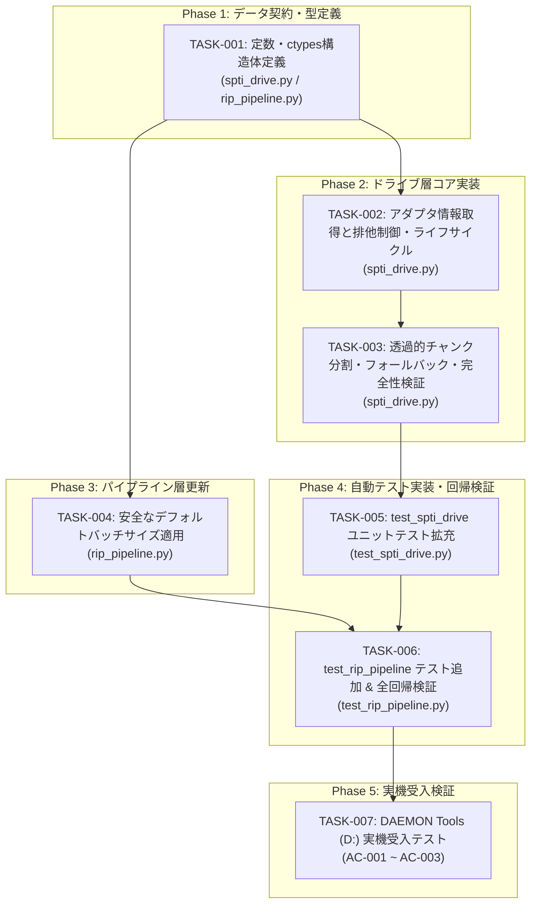

# 実装計画書 (Task Plan): SPTI転送長制限および仮想ドライブ対応 (Win32 エラー 87 解消)

- **Task ID**: cd-ripping-app-002
- **Author**: tech-lead
- **Status**: Ready for Implementation (Gate B Cleared)
- **Target Revision**: 33cbad8c2e277b89eb0747cbff2c17fa98c7e1e1
- **Target Components**: 
  - `cdripper.hardware.spti_drive`
  - `cdripper.pipeline.rip_pipeline`
  - `tests.test_spti_drive`
  - `tests.test_rip_pipeline`

---

## 1. 実装方針と依存グラフ (Implementation Strategy & Dependency Graph)

### 1.1 基本方針
- **多層防御 (Defense in Depth)**:
  1. `spti_drive.py` におけるアダプタ転送上限（`MaximumTransferLength` および `MaximumPhysicalPages`）の動的検出と透過的チャンク分割（Transparent Chunking）。
  2. `rip_pipeline.py` における安全な既定バッチサイズ（25セクタ ≈ 58.8KB < 64KB USB境界）への変更。
- **Fail-Fast & 完全性保証**:
  - 入力検証（`sector_count <= 0` は即時空バイト返却、オープン未完了時は例外）。
  - ループ不変量（`step >= 1`）によるハング・無限ループ完全排除（FIND-003）。
  - 各チャンクの長さ検証（ショートリード検知で即時例外送出）（FIND-004）。
  - `IOCTL_CDROM_RAW_READ` エラー時の恒久フォールバック（FIND-002）。
  - スレッドセーフティの確保（`threading.RLock`）およびクローズ時の完全初期化（FIND-006, FIND-007）。
- **後方互換性と無侵食性**:
  - `ICDDrive.read_sectors_raw` の外部インターフェースシグネチャを一切変更しない。
  - 既存のテストスイート（48テスト）を100%回帰させず、CIで完全検証可能とする。

### 1.2 依存関係グラフ (Mermaid)



---

## 2. API / データ契約 (API & Data Contracts)

### 2.1 定数定義
```python
# cdripper/hardware/spti_drive.py
DEFAULT_FALLBACK_SECTORS = 25  # 約58.8KB (< 64KB USB境界)
MIN_TRANSFER_SECTORS = 1
MAX_TRANSFER_SECTORS_CAP = 75  # 1秒分 (176.4KB)
CDDA_SECTOR_SIZE = 2352
PAGE_SIZE = 4096

# Win32 IOCTL & Query IDs
IOCTL_STORAGE_QUERY_PROPERTY = 0x002D1400
StorageAdapterProperty = 1
PropertyStandardQuery = 0

# cdripper/pipeline/rip_pipeline.py
DEFAULT_BATCH_SECTORS = 25  # 1/3秒分 (58,800 bytes)
```

### 2.2 ctypes 構造体定義 (`STORAGE_ADAPTER_DESCRIPTOR`)
```python
class STORAGE_ADAPTER_DESCRIPTOR(ctypes.Structure):
    _fields_ = [
        ("Version", ctypes.c_ulong),
        ("Size", ctypes.c_ulong),
        ("MaximumTransferLength", ctypes.c_ulong),
        ("MaximumPhysicalPages", ctypes.c_ulong),
        ("AlignmentMask", ctypes.c_ulong),
        ("AdapterUsesPio", ctypes.c_ubyte),
        ("AdapterScansDown", ctypes.c_ubyte),
        ("CommandQueueing", ctypes.c_ubyte),
        ("AcceleratedTransfer", ctypes.c_ubyte),
        ("BusType", ctypes.c_ubyte),
        ("BusMajorVersion", ctypes.c_ushort),
        ("BusMinorVersion", ctypes.c_ushort),
        ("SrbType", ctypes.c_ubyte),
        ("AddressType", ctypes.c_ubyte),
    ]
```

### 2.3 メソッド契約仕様

#### `WindowsSPTICDDrive.read_sectors_raw(start_lba: int, sector_count: int) -> bytes`
- **事前条件**:
  - ドライブが `open()` されていること（オープンされていない場合 `CDDriveNotFoundError` 送出）。
  - `start_lba >= 0`
- **事後条件**:
  - `sector_count <= 0` の場合、即座に空バイト `b""` を返却。
  - `sector_count > 0` の場合、正確に `sector_count * 2352` バイトのデータを返却。
  - 不完全長データの場合、中途半端なデータを返却せず `CDDriveReadError` を送出。
- **不変条件**:
  - `sector_count` がアダプタ制限を超過していても内部で `step` 単位に透過的分割され、Win32 エラー 87 を発生させない。
  - `step = max(MIN_TRANSFER_SECTORS, self._max_transfer_sectors)` によりループステップ幅は必ず 1 以上。

#### `read_track_sectors(drive, track, on_chunk, cancel_token=None, batch_size=DEFAULT_BATCH_SECTORS) -> None`
- デフォルトバッチサイズを 25 セクタとし、外部から `batch_size` が指定された場合も引数を尊重する。

---

## 3. タスク詳細一覧 (Task Breakdown)

### TASK-001: データ契約・定数・ctypes構造体の定義
- **担当責務**: 実装者 (Implementer)
- **対象ファイル**:
  - `cdripper/hardware/spti_drive.py`
  - `cdripper/pipeline/rip_pipeline.py`
- **依存タスク**: なし
- **変更内容**:
  - `spti_drive.py` に `DEFAULT_FALLBACK_SECTORS`, `MIN_TRANSFER_SECTORS`, `MAX_TRANSFER_SECTORS_CAP`, `CDDA_SECTOR_SIZE`, `PAGE_SIZE`, `StorageAdapterProperty` を追加。
  - `spti_drive.py` に `STORAGE_ADAPTER_DESCRIPTOR` クラスを定義。
  - `rip_pipeline.py` に `DEFAULT_BATCH_SECTORS = 25` を定義。
- **完了条件**:
  - 各ファイルが構文エラーなく読み込め、新規シンボルが正しく参照できること。

### TASK-002: アダプタ転送長クエリと排他制御・ライフサイクル管理の実装
- **担当責務**: 実装者 (Implementer)
- **対象ファイル**: `cdripper/hardware/spti_drive.py`
- **依存タスク**: TASK-001
- **変更内容**:
  - `__init__`:
    - `self._lock = threading.RLock()` を追加。
    - `self._max_transfer_sectors: int = DEFAULT_FALLBACK_SECTORS` を初期化。
    - `self._supports_raw_read: bool = True` を初期化。
  - `_query_adapter_transfer_limit(self) -> int`:
    - `StorageAdapterProperty` クエリを発行し、`MaximumTransferLength` と `MaximumPhysicalPages` から実効転送上限セクタ数を算出（FIND-001）。
    - 取得失敗時、記述子サイズ未満（FIND-008）、または異常値時は安全な既定値 `DEFAULT_FALLBACK_SECTORS` (25) を安全に返却。
    - 返却セクタ数を `[MIN_TRANSFER_SECTORS, MAX_TRANSFER_SECTORS_CAP]` にクランプ。
  - `open(self, drive_letter: str) -> bool`:
    - `with self._lock:` で排他保護。
    - ハンドル取得成功後、`self._max_transfer_sectors = self._query_adapter_transfer_limit()` を実行。
    - `self._supports_raw_read = True` をリセット。
  - `close(self) -> None`:
    - `with self._lock:` で排他保護（FIND-006）。
    - ハンドルクローズ後、`self._max_transfer_sectors = DEFAULT_FALLBACK_SECTORS`、`self._supports_raw_read = True` を初期化（FIND-007）。
  - `read_toc(self)` / `set_read_speed(self)`:
    - `with self._lock:` で排他保護（FIND-006）。
- **完了条件**:
  - ドライブオープン時に `_max_transfer_sectors` が適正に設定され、`close()` で初期状態に復元されること。

### TASK-003: 透過的チャンク分割・堅牢フォールバック・完全性検証の実装
- **担当責務**: 実装者 (Implementer)
- **対象ファイル**: `cdripper/hardware/spti_drive.py`
- **依存タスク**: TASK-002
- **変更内容**:
  - `read_sectors_raw(self, start_lba: int, sector_count: int) -> bytes`:
    - 入力検証（`sector_count <= 0` は `b""`、未オープン時は `CDDriveNotFoundError`）。
    - `with self._lock:`
    - `step = max(MIN_TRANSFER_SECTORS, self._max_transfer_sectors)`（FIND-003）。
    - `sector_count <= step` の場合は単一呼び出し。
    - `sector_count > step` の場合は `while remaining > 0:` ループで `_read_sectors_chunk` を呼び出し、`b"".join(chunks)` で結合して返却（FIND-005）。
  - `_read_sectors_chunk(self, start_lba: int, sector_count: int) -> bytes`:
    - 単一チャンク読み出しヘルパー。
    - `self._supports_raw_read` が True の場合は `IOCTL_CDROM_RAW_READ` を試行。
      - `ERROR_ACCESS_DENIED` 時は `CDDriveAccessDeniedError` を送出。
      - それ以外の任意のエラー（1, 87, 22, 50等）は `self._supports_raw_read = False` に更新し、恒久的に MMC READ CD へフォールバック（FIND-002）。
    - `self._supports_raw_read` が False の場合は直接 MMC READ CD (`_read_cd_mmc`) を実行。
    - Fail-Fast 長さ検証: `len(data) != sector_count * CDDA_SECTOR_SIZE` の場合は即座に `CDDriveReadError` を送出（FIND-004）。
- **完了条件**:
  - 100や150セクタ等の要求に対しても、上限以下に分割されて完全なデータ（要求セクタ数 * 2352 バイト）が返ること。

### TASK-004: パイプライン層の安全なデフォルトバッチサイズ適用
- **担当責務**: 実装者 (Implementer)
- **対象ファイル**: `cdripper/pipeline/rip_pipeline.py`
- **依存タスク**: TASK-001
- **変更内容**:
  - `read_track_sectors` のシグネチャを `batch_size: int = DEFAULT_BATCH_SECTORS` に更新。
- **完了条件**:
  - `batch_size` 省略時のデフォルト値が 25 となり、USB/仮想ドライブの転送上限内に自然に収まること。

### TASK-005: `tests/test_spti_drive.py` へのユニットテスト拡充
- **担当責務**: 実装者 (Implementer)
- **対象ファイル**: `tests/test_spti_drive.py`
- **依存タスク**: TASK-003
- **テストケース詳細**:
  1. `test_query_adapter_transfer_limit_normal`:
     - `MaximumTransferLength = 131072`, `MaximumPhysicalPages = 17` のモックで 55 セクタが返ること。
  2. `test_query_adapter_transfer_limit_page_bound`:
     - `MaximumTransferLength = 131072`, `MaximumPhysicalPages = 16` のモックで (16-1)*4096 = 61440 バイト = 26 セクタに制限されること (FIND-001)。
  3. `test_query_adapter_transfer_limit_failure_fallback`:
     - IOCTL 失敗時に既定値 25 セクタが返ること。
  4. `test_query_adapter_transfer_limit_short_descriptor`:
     - 返却バイト数が `sizeof(STORAGE_ADAPTER_DESCRIPTOR)` 未満の時に既定値 25 セクタが返ること (FIND-008)。
  5. `test_read_sectors_raw_zero_or_negative`:
     - `sector_count=0` や `-1` で即時 `b""` が返ること。
  6. `test_read_sectors_raw_transparent_chunking`:
     - `_max_transfer_sectors = 25` の状態で `read_sectors_raw(0, 75)` を実行し、`_read_sectors_chunk` が 3 回 (25, 25, 25) 呼ばれ、正しく結合されたデータが返ること (AC-002, FIND-005)。
  7. `test_read_sectors_raw_infinite_loop_prevention`:
     - `_max_transfer_sectors = 0` の異常値が設定されていても `step >= 1` で無限ループにならず終了すること (FIND-003)。
  8. `test_raw_read_fallback_on_any_error`:
     - `IOCTL_CDROM_RAW_READ` がエラー 1 や 87 を返した際、MMC READ CD にフォールバックし、`_supports_raw_read = False` に更新されること (FIND-002)。
  9. `test_read_sectors_chunk_incomplete_data_raises`:
     - ショートリード（返却バイト数不足）時に `CDDriveReadError` が送出されること (FIND-004)。
  10. `test_close_resets_state`:
      - `close()` 呼び出し後に `_max_transfer_sectors` と `_supports_raw_read` がデフォルト値にリセットされること (FIND-007)。
- **完了条件**:
  - 全追加テストが成功し、アサーションが期待通り機能すること。

### TASK-006: `tests/test_rip_pipeline.py` へのテスト追加および全回帰検証
- **担当責務**: 実装者 (Implementer)
- **対象ファイル**: `tests/test_rip_pipeline.py`
- **依存タスク**: TASK-004, TASK-005
- **変更内容**:
  - `test_read_track_sectors_default_batch_size_25`:
    - `batch_size` 省略時に 25 セクタ単位でコールバックが呼ばれることを検証。
  - 既存テスト `test_sector_boundary_calculation` (明示的 batch_size=75) および `test_cancel_token_stops_reading` の無回帰確認。
  - プロジェクト全テスト（48テスト + 新規テスト）の実行確認。
- **完了条件**:
  - `python -m unittest discover tests` が全テスト成功で終了すること。

### TASK-007: 実機環境（DAEMON Tools D:ドライブ）での受入検証
- **担当責務**: 実装者 / QAエンジニア
- **対象環境**: 実機 D: ドライブ (DAEMON Tools 仮想CDドライブ)
- **依存タスク**: TASK-006
- **検証内容**:
  - `WindowsSPTICDDrive.open("D:")` で `_max_transfer_sectors` が 55 に自動設定されることを確認。
  - `read_sectors_raw(0, 75)` を実行し、Win32 エラー 87 が発生せず、データが正常に取得できること (AC-001)。
  - `read_sectors_raw(0, 150)` で透過的チャンク分割による結合読み出しが成功すること (AC-002)。
  - `AudioRipPipeline` によるトラック 1 のリッピングおよびエンコードが正常に進行・完了すること (AC-003)。
- **完了条件**:
  - 実機上で Win32 error 87 が完全解消し、受入条件 AC-001〜AC-003 を充足すること。

---

## 4. 影響ファイル一覧と変更スコープ (Impacted Files)

| ファイルパス | 変更区分 | 変更概要 |
|---|---|---|
| `cdripper/hardware/spti_drive.py` | 修正 | 定数・構造体追加、`_query_adapter_transfer_limit`、`read_sectors_raw` チャンク分割、`_read_sectors_chunk`、RLock、`close` リセット |
| `cdripper/pipeline/rip_pipeline.py` | 修正 | `DEFAULT_BATCH_SECTORS = 25` 定義、`read_track_sectors` デフォルト値変更 |
| `tests/test_spti_drive.py` | 修正・追加 | アダプタ情報取得、チャンク分割、ショートリード検証、フォールバック、無限ループ防止テスト追加 |
| `tests/test_rip_pipeline.py` | 修正・追加 | デフォルトバッチサイズ検証テスト追加 |

---

## 5. 並列化可能な範囲と衝突リスク (Parallelization & Conflict Mitigation)

- **書き込み競合の排除**:
  - 本タスクの変更対象は実質的に `spti_drive.py` と `rip_pipeline.py` の 2 ファイルのみである。
  - 競合を完全に防ぎ、一貫したレビュー・テストサイクルを担保するため、**単一の実装者（Implementer）が TASK-001 から TASK-006 までを順次適用する**方針とする。
- **QA先行テスト設計との分離**:
  - QAテスト設計（Gate B ステップ 5）は本計画と並行して独立セッションで行われ、実装コードにはアクセスしない。

---

## 6. テスト・統合順序と検証コマンド (Testing & Verification Strategy)

### 6.1 検証コマンド
- **プロジェクト全テスト実行**:
  ```powershell
  & "C:\Users\nanko\AppData\Local\Python\bin\python.exe" -m unittest discover -s tests
  ```
- **個別モジュールテスト実行**:
  ```powershell
  & "C:\Users\nanko\AppData\Local\Python\bin\python.exe" -m unittest tests/test_spti_drive.py
  & "C:\Users\nanko\AppData\Local\Python\bin\python.exe" -m unittest tests/test_rip_pipeline.py
  ```

### 6.2 実行順序
1. 各タスク修正後、対象ユニットテストを実行し即時確認。
2. TASK-006 完了後、全テストディスカバリを実行（期待値: 既存48テスト + 新規11テスト = 59テスト全パス）。
3. TASK-007 にて実機 D: ドライブ検証を実施。

---

## 7. ロールバック手順とリスク軽減策 (Rollback & Risk Mitigation)

### 7.1 ロールバック基準
- 実装後に既存物理ドライブ（SATA/ATAPI）で読み込み性能が極端に低下した場合、または特定の光学ドライブで予期しない IOCTL エラーが発生した場合。

### 7.2 ロールバック手順
作業ツリーはコミット `33cbad8c2e277b89eb0747cbff2c17fa98c7e1e1` に基づいているため、万一の差し戻し時は以下を実行する：
```powershell
git checkout 33cbad8c2e277b89eb0747cbff2c17fa98c7e1e1 -- cdripper/hardware/spti_drive.py cdripper/pipeline/rip_pipeline.py tests/test_spti_drive.py tests/test_rip_pipeline.py
```
本変更は上位 UI 層やドメインモデル、メタデータ層には一切影響を与えないため、上記 4 ファイルの巻き戻しで安全かつ完全にロールバック可能である。

### 7.3 リスク軽減策
- **動的クエリ失敗リスク**: `IOCTL_STORAGE_QUERY_PROPERTY` が失敗、または不正な値を返した場合は、無条件に安全な既定値 `DEFAULT_FALLBACK_SECTORS` (25) を採用し例外送出を防止。
- **プロセスハングリスク**: ループ幅に `max(1, step)` を強制することで無限ループを数学的に防止。
- **ショートリード・データ破損リスク**: チャンク単位の長さ検証（`expected_bytes == len(data)`）により、破損データを後続に渡さない。

---

## 8. 完了判定基準 (Definition of Done)

- [ ] 受入条件 AC-001: DAEMON Tools (D:) で `read_sectors_raw(0, 75)` が Win32 エラー 87 なく成功すること。
- [ ] 受入条件 AC-002: 100 や 150 セクタの指定でも透過的にチャンク分割されて正確なバイト数が返ること。
- [ ] 受入条件 AC-003: DAEMON Tools (D:) でのリッピングパイプライン実行が正常に進行・完了すること。
- [ ] 受入条件 AC-004: 既存 48 テストを含む全テストが回帰なくパスすること。
- [ ] 受入条件 AC-005: チャンク分割・アダプタ上限取得・エラーフォールバックを網羅する新規テストがすべてパスすること。
- [ ] 設計指摘事項 FIND-001〜FIND-008 がすべて解消されていること。
- [ ] 凍結 diff に対する独立レビュー（Code Reviewer, Security Reviewer, Verification Auditor）にて P0/P1 指摘がゼロであること。
