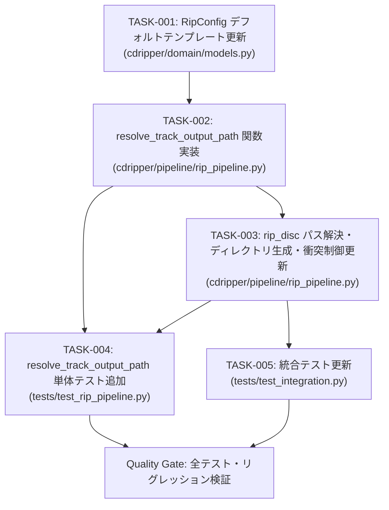

# Task Plan: `cd-ripping-app-004` (Implementation Plan)

- **Task ID**: `cd-ripping-app-004`
- **Feature**: 出力ディレクトリ階層化 (`<Album Artist>/<Album>/`) および トラックファイル名へのCD番号付与 (`{disc_number}-{track_num:02d} {title}{ext}`)
- **Design Status**: Approved (Rev 2 - CHALLENGE-001〜006 対応済み)
- **Author**: Tech Lead
- **Target Files**:
  - `cdripper/domain/models.py`
  - `cdripper/pipeline/rip_pipeline.py`
  - `tests/test_rip_pipeline.py`
  - `tests/test_integration.py`

---

## 1. タスク概要と完了条件 (Definition of Done)

### 1.1 タスク概要
本計画は、CDリッピング実行時に出力先ルートディレクトリ配下に `<Album Artist>/<Album>/` という階層を自動作成し、生成されるトラックファイル名を `{disc_number}-{track_num:02d} {title}{ext}`（例: `1-01 Come Together.m4a`）とする要求（FR-001, FR-002）を実装するための具体的な作業分割と契約定義である。

### 1.2 完了条件 (Definition of Done)
1. **[DoD-001] モデル契約準拠**: `cdripper/domain/models.py` の `RipConfig.filename_template` デフォルト値が `"{disc_number}-{track_num:02d} {title}{ext}"` に更新されていること。
2. **[DoD-002] 階層パス解決と堅牢性**: `cdripper/pipeline/rip_pipeline.py` に `resolve_track_output_path` が実装され、以下を完全に満たすこと：
   - 空タグ・空白・サニタイズ後空文字に対する明示的フォールバック（`"Unknown Artist"` / `"Unknown Album"`） (AC-002, CHALLENGE-002)
   - Windows 大文字小文字（`normcase`）および異ドライブ・UNC パス（`ValueError` 捕捉）に対応した安全なパストラバーサル防御 (AC-003, CHALLENGE-001)
   - MAX_PATH 制限対策（コンポーネント最大長 60文字制限） (CHALLENGE-004)
   - テンプレートの型安全（`int` 変換）および未定義キー・構文エラー時の安全なフォールバック (CHALLENGE-005)
3. **[DoD-003] パイプライン連携と上書き防止**: `AudioRipPipeline.rip_disc` が `resolve_track_output_path` を呼び出し、必要な親ディレクトリを自動生成するとともに、同一セッション内およびファイルシステム上の既存ファイルとの衝突回避（`os.path.exists` による連番 `_1`, `_2` 付与）が動作すること (AC-001, CHALLENGE-003)。
4. **[DoD-004] 単体テスト網羅**: `tests/test_rip_pipeline.py` に `resolve_track_output_path` の正常系・異常系・境界値・トラバーサル・予約語・MAX_PATH・上書き防止テストが追加され、全件合格すること。
5. **[DoD-005] 統合テスト追従**: `tests/test_integration.py` が新ディレクトリ階層および新命名規則に適合するよう更新され、E2Eテストが全件合格すること。
6. **[DoD-006] リグレッションなし**: 既存の全テストスイート（全123テスト以上）が全件合格すること。

---

## 2. 実装タスク一覧と依存関係

### 2.1 依存グラフ (Dependency Graph)



### 2.2 タスク仕様一覧

| Task ID | 責務 | 変更対象ファイル / シンボル | 依存先 | 完了条件 | 検証方法 |
|---|---|---|---|---|---|
| **TASK-001** | ドメインモデル設定更新 | `cdripper/domain/models.py`<br/>`RipConfig.filename_template` (L93-L100) | なし | `filename_template` デフォルト値が `"{disc_number}-{track_num:02d} {title}{ext}"` であること | `py -3 -m unittest discover -s tests -p "test_*.py"` |
| **TASK-002** | 階層パス解決・サニタイズ・トラバーサル防止関数の実装 | `cdripper/pipeline/rip_pipeline.py`<br/>`resolve_track_output_path` (モジュール関数追加) | TASK-001 | 設計書 4.1 の契約を実装し、CHALLENGE-001〜005 対策（フォールバック、トラバーサル防御、MAX_PATH、型安全）を含むこと | `py -3 -m unittest tests/test_rip_pipeline.py` (TASK-004 と連動) |
| **TASK-003** | パイプラインパス解決・ディレクトリ作成・衝突制御更新 | `cdripper/pipeline/rip_pipeline.py`<br/>`AudioRipPipeline.rip_disc` (L60-L234) | TASK-002 | `resolve_track_output_path` を呼び出し、各トラックのディレクトリ作成、`seen_output_paths` + `os.path.exists` の衝突連番付与が機能すること | 単体・統合テスト |
| **TASK-004** | 単体テスト追加 | `tests/test_rip_pipeline.py`<br/>`TestResolveTrackOutputPath` クラス追加 | TASK-002, TASK-003 | AC-001〜AC-006, CHALLENGE-001〜005 を網羅する11ケース以上の単体テストが全件合格すること | `py -3 -m unittest tests/test_rip_pipeline.py` |
| **TASK-005** | 統合テスト更新 | `tests/test_integration.py`<br/>`TestIntegrationE2E` (L29-L97, L98-L189) | TASK-003 | `<test_dir>/<Artist>/<Album>/<1-01 ...>` の新探索パスでタグ検証・E2Eテストが全件合格すること | `py -3 -m unittest tests/test_integration.py` |

---

## 3. 詳細実装契約 (Contracts Specification)

### 3.1 TASK-001: `RipConfig` (`cdripper/domain/models.py`)
```python
@dataclass
class RipConfig:
    """Configuration options for a ripping session."""
    output_dir: str
    format: EncodeFormat = EncodeFormat.AAC_256K
    selected_speed_x: int = 8
    speed_mode_auto: bool = True
    filename_template: str = "{disc_number}-{track_num:02d} {title}{ext}"
```

### 3.2 TASK-002: `resolve_track_output_path` (`cdripper/pipeline/rip_pipeline.py`)
```python
def resolve_track_output_path(
    base_output_dir: str,
    disc_number: int,
    track_number: int,
    track_title: str,
    album_artist: Optional[str] = None,
    album_name: Optional[str] = None,
    ext: str = ".m4a",
    filename_template: str = "{disc_number}-{track_num:02d} {title}{ext}",
    max_component_length: int = 60,
) -> str:
    """
    Resolve hierarchical output path: <base_output_dir>/<safe_artist>/<safe_album>/<safe_filename>
    with strict sanitization, path traversal prevention, and safe template substitution.
    """
    # 1. 厳格な型変換 (CHALLENGE-005)
    try:
        disc_num = max(1, int(disc_number))
    except (ValueError, TypeError):
        disc_num = 1

    try:
        trk_num = max(1, int(track_number))
    except (ValueError, TypeError):
        trk_num = 1

    # 2. 空・空白・サニタイズ後の明示的フォールバック (AC-002, CHALLENGE-002)
    raw_artist = (album_artist or "").strip()
    safe_artist = sanitize_filename(raw_artist, max_length=max_component_length)
    if not safe_artist or safe_artist == "Unknown":
        safe_artist = "Unknown Artist"

    raw_album = (album_name or "").strip()
    safe_album = sanitize_filename(raw_album, max_length=max_component_length)
    if not safe_album or safe_album == "Unknown":
        safe_album = "Unknown Album"

    raw_title = (track_title or "").strip()
    safe_title = sanitize_filename(raw_title, max_length=max_component_length)
    if not safe_title or safe_title == "Unknown":
        safe_title = f"Track {trk_num:02d}"

    # 3. Windows ドライブ・大文字小文字・UNC 安全なパストラバーサル防御 (CHALLENGE-001)
    abs_base = os.path.normcase(os.path.abspath(base_output_dir))
    target_dir = os.path.abspath(os.path.join(base_output_dir, safe_artist, safe_album))
    norm_target = os.path.normcase(target_dir)

    try:
        common = os.path.commonpath([abs_base, norm_target])
        if common != abs_base:
            target_dir = os.path.abspath(base_output_dir)
    except ValueError:
        # ドライブ文字不一致やUNCパス混在時の安全なフォールバック
        target_dir = os.path.abspath(base_output_dir)

    # 4. 安全なテンプレートフォーマットとサニタイズ (CHALLENGE-004, CHALLENGE-005)
    safe_ext = ext if ext.startswith(".") else f".{ext}"
    fmt_kwargs = {
        "disc_number": disc_num,
        "track_num": trk_num,
        "title": safe_title,
        "ext": safe_ext,
    }
    try:
        filename = filename_template.format(**fmt_kwargs)
    except Exception:
        filename = f"{disc_num}-{trk_num:02d} {safe_title}{safe_ext}"

    if not filename.endswith(safe_ext):
        filename = f"{filename}{safe_ext}"

    # ファイル名ベース部（拡張子除く）のNTFS禁止文字置換・最大長制限
    base_name, f_ext = os.path.splitext(filename)
    safe_base = sanitize_filename(base_name, max_length=max_component_length)
    filename = f"{safe_base}{f_ext}"

    return os.path.join(target_dir, filename)
```

### 3.3 TASK-003: `AudioRipPipeline.rip_disc` の改修点
1. メタデータ優先度解決:
   - `custom_tag` がある場合:
     - `eff_disc_num = custom_tag.disc_number`
     - `eff_track_num = custom_tag.track_number`
     - `eff_title = custom_tag.title`
     - `eff_album_artist = custom_tag.album_artist or custom_tag.artist`
     - `eff_album = custom_tag.album`
   - `custom_tag` がない場合:
     - `eff_disc_num = disc_number`
     - `eff_track_num = track_num`
     - `eff_title = itunes_meta.track_title if itunes_meta else f"Track {track_num:02d}"`
     - `eff_album_artist = (album.album_artist or album.artist_name) if album else (itunes_meta.artist_name if itunes_meta else "")`
     - `eff_album = album.album_name if album else ""`
2. 出力先解決とディレクトリ作成:
   ```python
   output_path = resolve_track_output_path(
       base_output_dir=config.output_dir,
       disc_number=eff_disc_num,
       track_number=eff_track_num,
       track_title=eff_title,
       album_artist=eff_album_artist,
       album_name=eff_album,
       ext=config.format.extension,
       filename_template=config.filename_template,
   )
   os.makedirs(os.path.dirname(output_path), exist_ok=True)
   ```
3. 衝突回避（セッション内およびディスク上の既存ファイル） (CHALLENGE-003):
   ```python
   if output_path in seen_output_paths or os.path.exists(output_path):
       base, fext = os.path.splitext(output_path)
       collision_idx = 1
       candidate = f"{base}_{collision_idx}{fext}"
       while candidate in seen_output_paths or os.path.exists(candidate):
           collision_idx += 1
           candidate = f"{base}_{collision_idx}{fext}"
       output_path = candidate
   seen_output_paths.add(output_path)
   ```

### 3.4 TASK-004: 単体テスト設計 (`tests/test_rip_pipeline.py`)
以下のテストケースを `TestResolveTrackOutputPath` クラスとして追加：
1. `test_resolve_normal`: 正常ケース（`<base>/The Beatles/Abbey Road/1-01 Come Together.m4a`）
2. `test_fallback_empty_artist_and_album`: `album_artist=""`, `album_name=""` 時に `Unknown Artist` / `Unknown Album` となること (AC-002, CHALLENGE-002)
3. `test_fallback_none_artist_and_album`: `album_artist=None`, `album_name=None` 時に `Unknown Artist` / `Unknown Album` となること (AC-002)
4. `test_sanitize_forbidden_chars_in_hierarchy`: ディレクトリ名に `:` や `/` や `*` があってもアンダースコア置換されること (AC-003)
5. `test_path_traversal_prevention_parent_dots`: アーティスト名に `../../` が入っても `base_output_dir` 外に出ず防御されること (AC-003, CHALLENGE-001)
6. `test_path_traversal_prevention_absolute_path`: アルバム名に `C:\Windows` などの絶対パスが入っても防御されること (CHALLENGE-001)
7. `test_disc_number_reflected_in_filename`: `disc_number=2`, `track_number=5` で `2-05 Track.m4a` となること (AC-004, AC-005)
8. `test_custom_template_backward_compatibility`: 旧来の `{track_num:02d} - {title}{ext}` テンプレートが安全に展開されること (FR-002)
9. `test_invalid_template_syntax_fallback`: 不正なテンプレート `{invalid_key}` が指定されても例外でクラッシュせずデフォルト形式にフォールバックすること (CHALLENGE-005)
10. `test_max_component_length_truncation`: 60文字を超える長大なフォルダ名・ファイル名が切り詰められ MAX_PATH を圧迫しないこと (CHALLENGE-004)
11. `test_collision_avoidance_with_existing_file_on_disk`: `tempfile` を使ってディスク上に同名ファイルを事前に作成した場合、`_1.m4a` として別名保存されること (CHALLENGE-003)

### 3.5 TASK-005: 統合テスト更新設計 (`tests/test_integration.py`)
1. `test_full_virtual_rip_pipeline`:
   - 探索先ディレクトリ: `os.path.join(self.test_dir, "The Beatles", "Abbey Road")`
   - 生成ファイル名: `1-01 Come Together.m4a`, `1-02 Something.m4a`
   - タグ検証対象ファイルパスを上記ディレクトリの `1-01 Come Together.m4a` に設定して `ffprobe` 検証。
2. `test_custom_track_tags_full_e2e_ffprobe_verification`:
   - `tag1` の `album_artist` を `"Custom Artist 1"`（または `"Various Artists"`）に設定、`album="Custom Compilation Vol. 1"`。
   - 探索先ディレクトリ: `os.path.join(self.test_dir, "Custom Artist 1", "Custom Compilation Vol. 1")`
   - 生成ファイル名: `1-01 AC_DC_ Live _Special_ _Edition_.m4a`
   - タグ検証対象ファイルパスを上記に変更して `ffprobe` 検証。

---

## 4. 並列化境界とファイル衝突リスク (Concurrency & Ownership)

- **原則**: オーケストレーション規約（Gate C）により、本番コードの書き込みは単一の `implementer` セッションでシーケンシャルに実施する。
- **ファイル衝突リスク**:
  - TASK-002 と TASK-003 は同じファイル `cdripper/pipeline/rip_pipeline.py` を変更するため、同一セッションでの連続実装が必須。
  - テストファイル（TASK-004, TASK-005）も `rip_pipeline.py` の実装完了後に作成・更新することでインターフェース不整合を防止する。
- **推奨実行順序**:
  `TASK-001` → `TASK-002` → `TASK-003` → `TASK-004` → `TASK-005`（すべて同一 Implementer で直列実施）

---

## 5. 影響範囲分析とリスク・ロールバック手順

### 5.1 影響範囲分析
- **UIレイヤ (`cdripper/ui/`)**: 変更なし。UIは `RipConfig.output_dir` を渡すのみであり、内部のディレクトリ階層化および命名規則変更は透過的に適用される。
- **ハードウェアレイヤ (`cdripper/hardware/`)**: 変更なし。セクタ読み込みに影響を与えない。
- **エンコーダレイヤ (`cdripper/pipeline/ffmpeg_encoder.py`)**: 変更なし。`start_encoding_session` に渡される `output_path` が階層化フルパスになるだけであり、エンコード処理や一時ファイル管理は既存ロジックがそのまま動作する。

### 5.2 リスクと対策
1. **Windows MAX_PATH (260文字) 制約**:
   - リスク: ディレクトリ階層化によりパス長が長くなり、NTFSでファイル作成に失敗する可能性。
   - 対策: `max_component_length=60` を適用し、アーティスト名、アルバム名、ファイル名各コンポーネントを最大60文字に制限（合計200文字前後に収まる）。
2. **既存ファイルの上書き**:
   - リスク: 過去のリッピング結果が存在する場合に黙って上書きしてしまう。
   - 対策: `os.path.exists` を衝突判定に組み込み、自動的に `_1`, `_2` を付与して上書きを阻止。
3. **パストラバーサル・予約語**:
   - リスク: 曲名やアルバム名に `../../` や `CON`, `AUX` が含まれる場合にファイルシステムエラーや任意パス書き込みの恐れ。
   - 対策: `sanitize_filename` で予約語・禁止文字を置換し、`os.path.commonpath` と `normcase` で脱出を遮断。

### 5.3 ロールバック手順
- 今回の変更は以下の4ファイルに完全に局所化されている：
  - `cdripper/domain/models.py`
  - `cdripper/pipeline/rip_pipeline.py`
  - `tests/test_rip_pipeline.py`
  - `tests/test_integration.py`
- 万が一予期せぬ障害が発生した場合は、`git restore <file>` またはコミット単位でのリバートにより即座にロールバック可能。

---

## 6. 検証手順（実行コマンド）

実装完了後、以下の順序で非破壊コマンドを実行し、終了コード 0 を確認する：

1. **パイプライン・パス解決単体テスト**:
   ```powershell
   py -3 -m unittest tests/test_rip_pipeline.py -v
   ```
2. **E2E統合テスト**:
   ```powershell
   py -3 -m unittest tests/test_integration.py -v
   ```
3. **全テストスイート回帰確認（123+テスト）**:
   ```powershell
   py -3 -m unittest discover -s tests -p "test_*.py" -v
   ```
